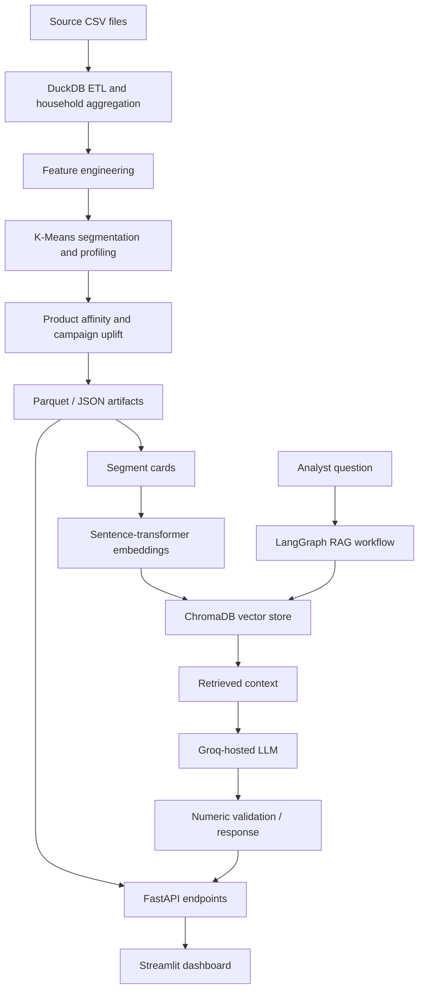

# Shopper Segmentation & Personalization Engine

An end-to-end retail analytics platform that converts grocery transaction and campaign data into **customer segments, product-affinity recommendations, campaign-uplift estimates, and grounded natural-language insights**.

The project combines a reproducible Python analytics pipeline with a FastAPI service, an interactive Streamlit dashboard, and a retrieval-augmented generation (RAG) analyst assistant.

> **Project status:** Research / portfolio project. Results depend on the supplied dataset, preprocessing choices, and statistical assumptions. Campaign uplift estimates are observational estimates—not proof of causal impact.

## Table of contents

- [Why this project](#why-this-project)
- [Key capabilities](#key-capabilities)
- [Architecture](#architecture)
- [Technology stack](#technology-stack)
- [Repository structure](#repository-structure)
- [Data requirements](#data-requirements)
- [Getting started](#getting-started)
- [Configuration](#configuration)
- [Run the analytics pipeline](#run-the-analytics-pipeline)
- [Run the application](#run-the-application)
- [API reference](#api-reference)
- [How the analytics work](#how-the-analytics-work)
- [RAG assistant and safeguards](#rag-assistant-and-safeguards)
- [Evaluation and sample findings](#evaluation-and-sample-findings)
- [Testing and code quality](#testing-and-code-quality)
- [Docker deployment](#docker-deployment)
- [Troubleshooting](#troubleshooting)
- [Limitations and responsible use](#limitations-and-responsible-use)
- [Potential next steps](#potential-next-steps)
- [License and data attribution](#license-and-data-attribution)

## Why this project

Retail teams often have plenty of transaction data but lack an accessible, repeatable way to turn it into practical customer insights. Customer segmentation can help analysts understand differences in purchasing behavior, while product affinity and campaign-response analysis can inform more relevant marketing experiments.

This project provides a complete workflow to:

1. Combine transaction, product, household, and campaign data.
2. Build household-level behavioral features.
3. Discover interpretable customer groups with clustering.
4. Profile segments and identify products with high relative purchase rates.
5. estimate campaign-associated spend differences with confidence intervals.
6. Explore results through a dashboard and ask questions through a RAG-based analyst assistant.

## Key capabilities

- **Data engineering:** DuckDB-based joins and aggregations across source CSV files, with Parquet artifacts for efficient downstream processing.
- **Feature engineering:** Recency/frequency/monetary-style signals, spend and trip metrics, promotional behavior, category mix, and demographic features where available.
- **Customer segmentation:** Standardized features and K-Means clustering, with candidate-cluster evaluation and additional stability checks.
- **Segment profiling:** Segment-level summaries and human-readable labels generated from behavioral characteristics.
- **Product affinity:** Lift-based product ranking that compares a segment's purchase rate with the overall population rate.
- **Campaign analysis:** Exposed-versus-control spend comparisons with 95% confidence intervals.
- **RAG analyst assistant:** Segment context is retrieved from a ChromaDB vector store and supplied to an LLM to answer natural-language questions.
- **Grounding guardrails:** Numeric claims in generated answers are checked against retrieved context.
- **Interactive analytics:** Streamlit pages for segment exploration, product recommendations, and analyst chat.
- **API and operational basics:** FastAPI endpoints, API-key protection for application routes, request rate limiting on chat, response caching, structured configuration, and automated tests.

## Architecture



**Pipeline flow:** raw CSVs → ETL → engineered features → clustering → personalization artifacts → RAG knowledge cards → API and dashboard.

The batch pipeline generates artifacts ahead of time. The API serves those artifacts rather than refitting the clustering model for every request. Natural-language chat is an on-demand operation and requires a configured Groq API key.

## Technology stack

| Area | Technologies |
|---|---|
| Data ingestion and transformation | Python, DuckDB, pandas, PyArrow, Parquet |
| Machine learning | scikit-learn, K-Means, StandardScaler, PCA, Gaussian Mixture Model validation |
| Product and campaign analytics | pandas, NumPy-style statistical calculations, confidence intervals |
| Embeddings and retrieval | Sentence Transformers (`all-MiniLM-L6-v2`), ChromaDB |
| LLM / orchestration | Groq API, LangChain, LangGraph |
| Backend | FastAPI, Uvicorn, HTTPX |
| Frontend and charts | Streamlit, Plotly |
| Testing and quality | pytest, Ruff, pip-audit, GitHub Actions |
| Packaging and deployment | `pyproject.toml`, pip requirements, Docker, Docker Compose |

## Repository structure

```text
.
├── .github/workflows/ci.yml        # Continuous integration workflow
├── data/                           # Optional local data staging (not committed)
├── frontend/
│   ├── app.py                      # Streamlit application entry point
│   ├── api_client.py               # FastAPI client
│   ├── charts.py                   # Plotly chart helpers
│   └── pages/
│       ├── 1_Segment_Overview.py   # Segment exploration
│       ├── 2_Recommendations.py    # Product affinity recommendations
│       └── 3_Analyst_Chat.py       # RAG analyst chat
├── output/                         # Generated artifacts (not committed)
├── scripts/
│   └── run_pipeline.sh             # Run batch pipeline modules 1–4
├── src/shopper_segmentation/
│   ├── api/                        # FastAPI app, authentication, sessions
│   ├── etl.py                      # Load, join, and aggregate source data
│   ├── features.py                  # Household feature engineering
│   ├── segmentation.py              # Clustering and segment profiles
│   ├── personalization.py           # Product affinity and campaign uplift
│   ├── artifacts.py                 # Artifact access helpers
│   └── rag/
│       ├── agent/                   # LangGraph state, nodes, prompts, graph
│       ├── evals/                   # RAG evaluation dataset and runner
│       ├── build_cards.py           # Build segment knowledge cards
│       ├── vectorstore.py           # ChromaDB index and retrieval
│       ├── tools.py                 # Structured lookup tools
│       └── rag_chain.py             # RAG chat and response guardrails
├── tests/                           # Unit and integration tests
├── .env.example                     # Configuration template
├── Dockerfile
├── docker-compose.yml
├── pyproject.toml                   # Package and tool configuration
├── requirements.txt
├── requirements.lock
└── README.md
```

## Data requirements

The pipeline uses the [dunnhumby Complete Journey](https://www.dunnhumby.com/sourcefiles) dataset. Obtain the data under the dataset provider's terms; it is **not redistributed by this repository**.

Configure `DATA_DIR` to point to a directory containing these eight CSV files:

```text
shopper-data/
├── transaction_data.csv
├── product.csv
├── hh_demographic.csv
├── campaign_table.csv
├── campaign_desc.csv
├── coupon.csv
├── coupon_redempt.csv
└── causal_data.csv
```

The directory can be outside the repository. Keep private or licensed data out of Git. The repository's included sample JSON artifacts are examples and are not a substitute for running the pipeline on the intended source data.

## Getting started

### Prerequisites

- Python **3.11 or newer**
- pip and `venv`
- The dunnhumby CSV files listed above
- A Groq API key for natural-language chat
- Git (optional but recommended)

The batch analytics and dashboard/API can be explored separately from LLM chat; the chat feature needs a valid `GROQ_API_KEY`.

### 1. Clone or download the repository

```bash
git clone <your-repository-url>
cd customer-segmentation-rag-platform
```

If you downloaded a ZIP, extract it and open a terminal in the extracted project directory. Replace the example repository URL and directory name with your actual values.

### 2. Create and activate a virtual environment

**Linux / macOS / Ubuntu**

```bash
python3 -m venv .venv
source .venv/bin/activate
python -m pip install --upgrade pip
```

**Windows PowerShell**

```powershell
py -3.11 -m venv .venv
.\.venv\Scripts\Activate.ps1
python -m pip install --upgrade pip
```

### 3. Install the project

For editable installation with development tools:

```bash
pip install -e ".[dev]"
```

Alternatively, install runtime dependencies with:

```bash
pip install -r requirements.txt
pip install -e .
```

If you need a reproducible environment, use the repository's lockfile where compatible with your Python and platform:

```bash
pip install -r requirements.lock
pip install -e ".[dev]"
```

### 4. Configure environment variables

Copy `.env.example` to `.env`, then update the values for your machine. Never commit `.env` or real API keys.

Linux / macOS:

```bash
cp .env.example .env
```

Windows PowerShell:

```powershell
Copy-Item .env.example .env
```

Edit at least `DATA_DIR` and `API_KEY`. Set `GROQ_API_KEY` to enable chat. See [Configuration](#configuration) for details.

## Configuration

| Variable | Required | Purpose |
|---|---|---|
| `DATA_DIR` | For pipeline | Absolute or relative path to the eight source CSVs |
| `GROQ_API_KEY` | For chat | API key for Groq-hosted LLM inference |
| `API_KEY` | For protected API routes | Secret expected in the `X-API-Key` request header; replace the example value |
| `ALLOWED_ORIGINS` | No | Comma-separated browser origins allowed by CORS |
| `API_BASE_URL` | No | API base URL used by the frontend; defaults to local FastAPI |
| `CHAT_CACHE_TTL_SECONDS` | No | Lifetime of cached chat responses; default is 3600 seconds |
| `MIN_SEGMENT_CONFIDENT_N` | No | Minimum segment population used for confidence-related profile messaging; default is 30 |
| `LANGCHAIN_TRACING_V2` | No | Enable LangSmith tracing when configured |
| `LANGCHAIN_API_KEY` | No | LangSmith API key for tracing |
| `LANGCHAIN_PROJECT` | No | LangSmith project name |
| `CHECKPOINT_DB_PATH` | No | SQLite checkpoint database path for the agent |

Example configuration (use paths appropriate for your computer):

```env
DATA_DIR=/absolute/path/to/shopper-data
GROQ_API_KEY=your-groq-api-key
API_KEY=replace-with-a-long-random-secret
ALLOWED_ORIGINS=http://localhost:8504
CHAT_CACHE_TTL_SECONDS=3600
MIN_SEGMENT_CONFIDENT_N=30
LANGCHAIN_TRACING_V2=false
LANGCHAIN_API_KEY=
LANGCHAIN_PROJECT=shopper-segmentation
CHECKPOINT_DB_PATH=output/checkpoints.sqlite
```

Do not use the example API key in a deployed environment. Treat API keys and tracing credentials as secrets. If LangSmith tracing is enabled, review its data-handling terms before sending prompts or retrieved content to the service.

## Run the analytics pipeline

Run from the repository root with the virtual environment activated and `DATA_DIR` configured.

### Option A: Run all batch steps

On Linux / macOS / Ubuntu:

```bash
bash scripts/run_pipeline.sh
```

### Option B: Run modules individually

```bash
python -m shopper_segmentation.etl
python -m shopper_segmentation.features
python -m shopper_segmentation.segmentation
python -m shopper_segmentation.personalization
```

Build or exercise the RAG chain/index separately when needed:

```bash
python -m shopper_segmentation.rag.rag_chain
```

The exact RAG indexing lifecycle is managed by the implementation; the vector index may also be initialized lazily when retrieval is first used.

### Generated artifacts

The pipeline writes generated files under `output/` (the directory is intended for local artifacts, not source control):

| Artifact | Purpose |
|---|---|
| `household_features_raw.parquet` | Household aggregates after ETL |
| `household_features.parquet` | Engineered feature matrix used by clustering |
| `household_segments.parquet` | Segment assignments and PCA coordinates |
| `segment_profiles.json` | Segment metrics and profile metadata |
| `segment_profiles.md` | Human-readable segment summary |
| `segment_recommendations.json` | Product-affinity rankings by segment |
| `uplift_report.json` | Campaign-associated spend differences and intervals |
| `chroma/` | Persistent vector index for segment cards |

Run the pipeline again after changing the input data or feature logic so downstream artifacts remain consistent.

## Run the application

### 1. Start the API

From the project root:

```bash
uvicorn shopper_segmentation.api.app:app --host 127.0.0.1 --port 8000 --reload
```

### 2. Start the dashboard

Open a second terminal, activate the same virtual environment, and run:

```bash
streamlit run frontend/app.py --server.port 8504
```

### 3. Open the services

| Service | Address |
|---|---|
| Streamlit dashboard | http://localhost:8504 |
| FastAPI OpenAPI documentation | http://127.0.0.1:8000/docs |
| FastAPI ReDoc | http://127.0.0.1:8000/redoc |
| Health check | http://127.0.0.1:8000/health |

The API needs the relevant generated artifacts to exist. Run the batch pipeline first if you want to serve results computed from your own dataset.

## API reference

Protected endpoints require the `X-API-Key` header. The health endpoint is public.

| Method | Endpoint | Authentication | Description |
|---|---|---|---|
| `GET` | `/health` | No | Health check |
| `GET` | `/segments` | Yes | List available segments |
| `GET` | `/segments/{id}` | Yes | Retrieve a segment and its profile information |
| `GET` | `/segments/{id}/recommendations` | Yes | Retrieve product recommendations for a segment |
| `POST` | `/chat` | Yes | Ask a natural-language question using RAG |

### Example requests

Health check:

```bash
curl http://127.0.0.1:8000/health
```

List segments (replace the placeholder with the `API_KEY` from your `.env`):

```bash
curl -H "X-API-Key: YOUR_API_KEY" \
  http://127.0.0.1:8000/segments
```

Ask the analyst assistant:

```bash
curl -X POST http://127.0.0.1:8000/chat \
  -H "Content-Type: application/json" \
  -H "X-API-Key: YOUR_API_KEY" \
  -d '{"query":"Which segments show the strongest campaign response?"}'
```

Chat requests are rate-limited. Depending on configuration and service status, chat may return `503` when the LLM API key is unavailable, `429` when rate limited, or `502` when upstream LLM inference fails. Refer to `/docs` for the precise response schema exposed by the running version.

## How the analytics work

### 1. ETL and feature engineering

DuckDB loads and joins the source files, then aggregates transaction behavior to the household level. The feature layer derives measures such as spend, trip frequency, promotional behavior, category mix, and demographic indicators when the source data supports them. Intermediate tables are persisted in Parquet for efficient processing.

### 2. Customer segmentation

The segmentation workflow standardizes numeric features and fits K-Means models across candidate cluster counts. Silhouette scores are used during selection, with complementary checks including a Gaussian Mixture Model comparison and bootstrap resampling. PCA coordinates are used to help visualize segments; PCA is not itself the clustering algorithm.

Segment names are descriptive labels inferred from profile characteristics. They should be interpreted as summaries of observed behavior, not fixed identities or ground-truth customer types.

### 3. Product affinity

For a product and segment, lift is calculated as:

```text
product lift = purchase rate within segment / purchase rate in the full population
```

A lift above `1.0` means the product is purchased more frequently in that segment than in the overall population. Lift should be considered alongside support/sample size; rare products can have high lift from very few purchases.

### 4. Campaign-associated uplift

The pipeline compares spend between campaign-exposed households and a comparison group and reports the estimated difference with a 95% confidence interval. Because the analysis can be affected by selection bias, confounding, and the construction of the comparison group, these estimates should be treated as **associations unless the study design justifies causal interpretation**. Validate campaign decisions with a controlled experiment where possible.

## RAG assistant and safeguards

The analyst assistant combines retrieval with LLM generation rather than asking the LLM to answer solely from its pretrained knowledge.

1. Segment profiles are converted into compact knowledge cards.
2. The cards are embedded using `sentence-transformers/all-MiniLM-L6-v2`.
3. ChromaDB retrieves relevant cards for a user query.
4. Retrieved context is passed to a Groq-hosted Llama model through the LangChain/LangGraph workflow.
5. Numeric claims are checked against retrieved context before the response is returned.

The retrieval workflow is designed to make answers more traceable to the computed artifacts, but guardrails do not guarantee that every answer is correct. Review the source profile or report before using an answer to make a business decision. Model availability, model names, and provider limits can change over time.

Optional LangSmith tracing can help inspect agent execution. Enable it only after configuring the relevant environment variables and considering whether the traced data is appropriate to send to an external service.

## Evaluation and sample findings

The repository's documented run reports the following values for a sample analysis of 2,500 households. Re-run the pipeline to verify these values for your local dataset and code version.

### Clustering diagnostics

| Diagnostic | Reported value |
|---|---:|
| Selected cluster count | 8 |
| Silhouette score at `k = 8` | 0.338 |
| GMM adjusted Rand index vs. K-Means | 0.751 |
| Mean bootstrap adjusted Rand index | 0.557 |

These are diagnostics, not universal quality guarantees. In particular, bootstrap stability indicates that some cluster assignments may be sensitive to resampling; inspect cluster sizes and profiles before drawing conclusions.

### Example campaign and product signals

| Example signal | Reported value |
|---|---:|
| Segment 0 campaign-associated incremental spend | +124.6% (95% CI: 116.8%–132.5%) |
| Segment 2 campaign-associated incremental spend | +44.3% (95% CI: 32.7%–55.9%) |
| Segment 6 campaign-associated incremental spend | +42.4% (95% CI: 30.6%–55.9%)* |

\*Use the generated `uplift_report.json` as the source of truth for your run; reported sample summaries can change as code or data changes.

For one reported segment-2 product example, product ID `12171407` had a lift of `10.66×` with a segment purchase rate of `0.149`. High lift alone does not establish commercial value; examine absolute purchase rates, support, margin, and campaign feasibility.

**Important:** Sample figures are included to make the evaluation approach concrete, not to claim that the results will reproduce on every machine or dataset variant.

## Testing and code quality

Run tests from the project root:

```bash
pytest tests/ -v
```

Run lint checks:

```bash
ruff check src tests frontend
```

The repository includes unit and integration tests covering key ETL, feature, segmentation/personalization, artifact, API, vector-store, and RAG behavior. A test suite passing locally does not replace validation against the full licensed dataset and your own deployment configuration.

The GitHub Actions workflow provides an automated CI entry point. Review its current configuration before relying on it as a production security or compatibility guarantee.

## Docker deployment

Docker and Docker Compose files are included for containerized development. Docker is optional for local Python execution.

1. Install Docker Engine/Desktop and the Compose plugin.
2. Create and configure `.env` as described above.
3. Ensure `DATA_DIR` points to the directory containing the required CSV files and is mounted correctly by Compose.
4. Build and start the services:

```bash
docker compose up --build
```

5. Open the dashboard at http://localhost:8504 and API docs at http://localhost:8000/docs.

The Compose configuration starts the API and Streamlit services; it does not automatically guarantee that the complete analytics pipeline has been run against your data. Generate the required artifacts before expecting meaningful segment results. For a public deployment, add production-grade secret management, TLS/reverse proxy configuration, stronger access controls, monitoring, and resource limits.

## Troubleshooting

- **`ModuleNotFoundError: shopper_segmentation`:** Activate the project virtual environment and run `pip install -e .` from the repository root.
- **No input CSVs / file not found:** Check that `DATA_DIR` points to the directory containing all eight required filenames. Use an absolute path if in doubt.
- **Missing segment artifacts:** Run the ETL, feature, segmentation, and personalization steps in order.
- **Chat unavailable:** Verify `GROQ_API_KEY`, network access, provider quota, and the configured model. Segment endpoints may work even when chat is unavailable.
- **Protected API returns unauthorized:** Ensure the request includes `X-API-Key` with the exact configured `API_KEY` value.
- **Frontend cannot reach the API:** Check that FastAPI is running and that `API_BASE_URL` points to the correct host and port. With Docker Compose, the frontend uses the Compose service hostname.
- **Dependency installation fails:** Use Python 3.11+, upgrade pip, and install inside a fresh virtual environment. Some ML dependencies may take time or require platform-specific wheels.
- **Unexpected or stale results:** Re-run the pipeline after changing source data or transformation logic, and check the timestamps and contents of generated artifacts.

## Limitations and responsible use

- Segment quality depends on data quality, feature design, scaling, and the selected clustering algorithm.
- Segment labels are interpretive summaries and should not be treated as objective or permanent customer identities.
- Small clusters may produce unstable profiles and exaggerated product lift; apply minimum-support rules and report uncertainty.
- Campaign uplift estimates may be biased by non-random campaign exposure and should not automatically be interpreted as causal effects.
- RAG output can still be incomplete or incorrect, even with retrieval and numeric validation.
- Do not put credentials, confidential customer data, or licensed source data in public repositories or logs.
- Before real-world use, assess privacy, consent, data retention, security, fairness, and the legal terms governing the source dataset and model providers.

## Potential next steps

- Add time-based validation and monitor segment drift as new transactions arrive.
- Compare K-Means with alternatives such as Gaussian Mixture Models or density-based clustering using a documented evaluation protocol.
- Improve cluster stability and small-segment handling; expose support counts and uncertainty in the UI.
- Add formal RAG evaluations for retrieval relevance, answer groundedness, numeric faithfulness, and refusal behavior.
- Expand API integration tests, request-level observability, and deployment security checks.
- Introduce a controlled A/B-test workflow for measuring campaign effectiveness.
- Add data-quality checks, schema validation, incremental ingestion, and reproducible artifact/version metadata.
- Add user/role management and production secret management before exposing the application beyond a trusted environment.

## License and data attribution

Review the repository's `LICENSE` file for the code license. The dunnhumby Complete Journey dataset is separately governed by its provider's terms and is not included in this repository. Users are responsible for obtaining the dataset appropriately and complying with all applicable terms.

---

Built as an end-to-end portfolio project exploring retail data engineering, unsupervised learning, personalization analytics, API development, and retrieval-augmented generation.
